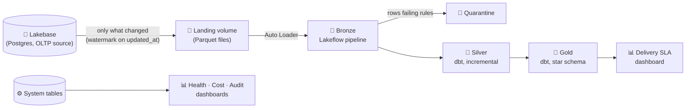
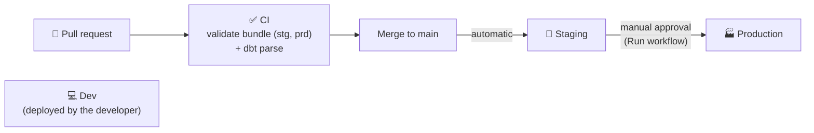

# 📦 Olist Delivery SLA Platform

**Databricks Upskill Program capstone.** A governed data platform on the real
[Olist](https://www.kaggle.com/datasets/olistbr/brazilian-ecommerce) e-commerce dataset (~100k orders),
built to answer one business question:

> **Which orders break their promised delivery date, and where is the delay concentrated?**


---

## 🎯 The answer

| | |
|---|---|
| 📬 **Delivered orders** | 96,471 |
| ⏰ **Late orders** | 6,535 (**6.8%**) |
| 📅 **Average delay when late** | **10.6 days** |
| 📍 **Worst late rate** | Alagoas 21.4% · Maranhão 17.4% |
| 🏙️ **Most late orders** | São Paulo (~1,820) + Rio (~1,500), about half of all late orders |
| 📈 **Peaks** | December 2017 and March 2018 |

**What it means:** two different problems. Remote states have *unrealistic promises* (high rate,
low volume); Rio has *high rate and high volume*, which makes it the first place to act.

---

## 🏗️ Architecture



Everything runs on **serverless** compute, is governed by **Unity Catalog**, and is deployed by a
**Databricks Asset Bundle** through **GitHub Actions**.

---

## 🔁 How one refresh works

A single job runs three steps in order. If one fails, the next ones don't run, so Gold never shows half-updated data.

| Step | What it does |
|---|---|
| 1️⃣ `extract_lakebase` | Pulls **only the rows that changed** in Lakebase since the last run and saves them as Parquet files |
| 2️⃣ `refresh_bronze` | Loads the new files, **checks data quality rules**, sends bad rows to quarantine, keeps the **latest version** of each record (CDC) |
| 3️⃣ `dbt_build` | **Cleans** the data (Silver), builds the **star schema** (Gold) and runs the **tests** |

⏱️ About 4 minutes end to end.

---

## 🥉🥈🥇 Data layers

| Layer | Built with | What's inside |
|---|---|---|
| **Landing** | Notebook + volume | Raw incremental extracts from Lakebase |
| **Bronze** | Lakeflow Declarative Pipeline | `<table>_history` (every valid change), `<table>` (current state, AUTO CDC) |
| **Quarantine** | Lakeflow expectations | `<table>_rejected`, with the list of rules each row failed |
| **Silver** | dbt (incremental) | Standardized customers, sellers, products, orders, order items |
| **Gold** | dbt (tables) | `fct_order_delivery`, `dim_customer`, `dim_seller`, `dim_date`, `agg_sla_by_state_day` |

### ✅ Data quality
Bad rows **never stop the pipeline**. They are dropped from Bronze and kept in quarantine with
the reason, for example:

- 8 orders marked *delivered* with no delivery date
- 4 order items with a shipping limit after the dataset ends
- 5 payments with an unknown type or zero installments

---

## 🚀 Environments and CI/CD



- **Same code, three environments:** dev, stg and prd, as schemas `olist_<env>_<layer>`. Only the variables change.
- **CI** runs on every PR. **Staging** deploys on merge. **Production** deploys only on a manual trigger.
- GitHub Actions authenticates as a **service principal (OAuth M2M)**. There are no personal tokens.

---

## 🔐 Governance

| | How |
|---|---|
| **Access control as code** | `permissions` and `grants` in `databricks.yml` |
| **PII masking** | Customer zip code and city are **masked in Gold** (`01***`, `REDACTED`) for anyone outside `olist_pii_readers`, and tagged `pii = quasi_identifier`. Silver keeps raw values behind schema permissions |
| **Lineage** | Automatic in Unity Catalog, from Bronze to the dashboards |
| **No secrets in code** | Lakebase uses short-lived OAuth tokens generated at runtime; CI secrets are encrypted in GitHub |
| **Audit** | Every access to project objects is visible in the Audit dashboard |

---

## 📊 Dashboards (AI/BI)

| Dashboard | Answers |
|---|---|
| **Olist · Delivery SLA** | Late rate, late orders by state, trend by month |
| **Olist · Pipeline Health** | Runs, success rate, task durations, data quality by rule (pipeline event log) |
| **Olist · Cost** | DBUs and estimated cost per job/pipeline. The whole project cost about **$2** of compute |
| **Olist · Audit** | Who accessed what, top actions, permission denials |

---

## 📂 Repository

```
├── databricks.yml                  # Asset Bundle: variables, targets, permissions
├── resources/
│   ├── bronze_pipeline.yml         # Bronze Lakeflow pipeline
│   └── refresh_job.yml             # extract → bronze → dbt job
├── src/
│   ├── setup/01_load_lakebase      # One-time seed of Lakebase with the Olist CSVs
│   ├── ingestion/02_extract_lakebase   # Incremental extract (watermark)
│   ├── pipeline/bronze.py          # Bronze: Auto Loader, expectations, quarantine, AUTO CDC
│   └── tools/simulate_order_update # Changes one order to test CDC end to end
├── dbt/
│   ├── models/silver/              # Cleaning and standardization
│   ├── models/gold/                # Star schema + SLA aggregate
│   └── macros/                     # Schema naming, PII mask functions
└── .github/workflows/
    ├── ci.yml                      # Validation on every PR
    └── deploy.yml                  # stg on merge, prd on demand
```

---

## ▶️ Running it

1. **Seed the source** (once): run `src/setup/01_load_lakebase` to load the Olist CSVs into Lakebase.
2. **Deploy dev**: from the workspace Git folder, open the bundle and **Deploy** the `dev` target.
3. **Run** the job `[dev <user>] olist_dev_refresh`.
4. **Test CDC** (optional): run `src/tools/simulate_order_update`, then run the job again; the change flows to Gold.

stg and prd are deployed by GitHub Actions; see *Environments and CI/CD*.

---

## 🔭 Next steps

- **Streaming:** an order-status event loop through **Zerobus** into a streaming table
- **Databricks App** on top of Gold
- **Scheduled runs** for staging and production (requires a Lakebase role for the service principal)
- Deeper analysis: **seller → customer routes** and the impact of delays on **review scores**

---

<sub> Databricks Upskill Program · October 2026</sub>
